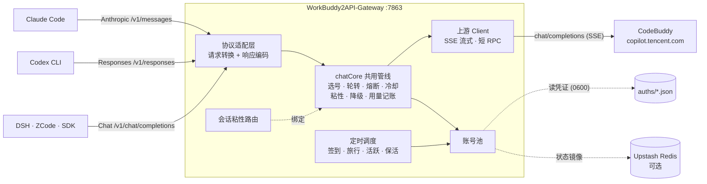

# WorkBuddy2API-Gateway


**多协议 API 网关 —— 让 Claude Code、Codex CLI、DSH、ZCode、OpenAI SDK 按原生协议直连你的 CodeBuddy 账号池。**

WorkBuddy2API-Gateway 把腾讯 CodeBuddy（`copilot.tencent.com`）账号封装成一个统一推理服务入口：**三种入站协议同端口并存**（OpenAI Chat Completions / Anthropic Messages / OpenAI Responses），外来模型名自动映射，账号池统一治理（选号 / 熔断 / 冷却 / 粘性 / 降级 / 记账），自带 Web 管理面板。客户端**不需要 CCR 等第三方转换层**——少一跳转换，就少一处丢字段。

> ⚠️ 本项目为**非官方**网关，使用 CodeBuddy 账号作为上游，仅限**本人授权账号、本机 / 私有环境**使用。

## 目录

- [本项目新增了什么](#-本项目新增了什么)
- [架构总览](#架构总览)
- [多协议入站](#-多协议入站)
- [模型名映射](#️-模型名映射)
- [客户端接入速查](#客户端接入速查)
- [快速开始](#快速开始)
- [API 端点](#api-端点)
- [Web 管理面板](#️-web-管理面板)
- [配置速览](#配置速览)
- [文档](#文档)
- [上游与致谢](#上游与致谢)

## 使用声明（必读）

本项目的开发初衷只有一个：**方便个人管理自己的 CodeBuddy 账号**——自动签到、保活、给自己的本地工具提供标准 API 入口。免费、开源、按「原样」提供。

近期发现有人将本项目用于：批量注册小号 / 收购账号对外提供付费 API、共享池；二次加壳捆绑卡密售卖。对此声明：

1. **一切商用 / 售卖行为与本项目及作者无关**，后果由行为人自行承担；
2. 批量注册与转售接口配额违反目标平台服务条款，正在毁掉所有正常使用者的环境；
3. **请勿购买任何「收费版」「卡密版」「公益中转版」**——任何加壳收费的「版本」都是他人篡改的产物，且存在窃取你 CodeBuddy 凭证的风险（`auths/` 中保存的是明文 accessToken）；
4. 本项目基于 MIT 协议开源，协议赋予代码层面的自由，**不赋予**以本项目名义宣传、售卖或要求作者背书的权利；
5. 若滥用持续，作者可能随时停止维护或删除仓库，不另行通知。

如果你的用途是管理自己的账号，欢迎正常使用、反馈问题与提交 PR。

## ✨ 本项目新增了什么

本仓库在 fork 链（见[上游与致谢](#上游与致谢)）之上，重点补齐了「**协议层**」与「**开箱体验**」：

| 新增能力 | 说明 |
|---|---|
| **🔑 Anthropic Messages 入站** | `POST /v1/messages`（另 `POST /v1/messages/count_tokens` 本地估算）：请求结构转换（system 数组 / content block / `tool_use` / `tool_result` / `input_schema` / image）、SSE 帧级事件翻译（`message_start → content_block_* → message_delta → message_stop`，文本 / thinking / tool_use 三类 block）、非流式整包翻译、错误信封翻译——**Claude Code 原生直连** |
| **🔑 OpenAI Responses 入站** | `POST /v1/responses`：`input` item 数组（message / function_call / function_call_output / reasoning）、平铺 `tools`、`reasoning.effort`、`text.format` 约束转译；流式事件序列带递增 `sequence_number`，工具调用走 `function_call_arguments.delta`——**Codex CLI 原生直连** |
| **🗺️ 模型名映射（别名表）** | 客户端爱用什么模型名都行：外来名（`claude-*` / `gpt-*`）按通配规则（顺序首中即停、大小写不敏感）映射到上游模型，上游真实模型名原样透传，都不中回落 `default_model`；`inbound.model_alias` 可完全自定义，映射动作记运行日志 |
| **🧩 协议适配零复制治理** | 适配层只做「请求解析 + 响应编码」两段转换，中段治理（选号 / 轮转 / 熔断 / 冷却 / 粘性 / 降级 / 用量记账）与 chat/completions **共用同一条 `chatCore` 管线**——不为第二、三套协议复制轮转逻辑，三条协议行为完全一致 |
| **🖥️ 面板接入信息卡** | 账号池顶部常驻「接入信息」卡：三协议端点一键复制 + API Key 回显，新用户第一个问题第一眼有解 |
| **📋 日志页体现多协议** | 请求记录表新增「协议」列（OpenAI / Anthropic / Responses 三色徽标，按真实入站端点记账）；发生模型名映射时模型列显示「原始名 → 解析名」；协议与原始模型名可加入搜索；根路径 `/` 自动跳转面板 |
| **🪟 Windows 一键脚本** | `start.bat` / `stop.bat`（UTF-8 + chcp 65001，端口幂等，关窗即停）；Release 提供预编译单文件二进制，双击即用 |
| **📖 使用手册** | [docs/user-manual.md](docs/user-manual.md)（12 章 / 633 行）：项目介绍、快速开始、面板详解、五客户端接入、模型映射规则、配置完全参考、运维排错、FAQ |

### 继承自 fork 链的既有能力（概览）

以下能力随 fork 继承并在真实多账号环境长期验证，详见手册：

| 能力 | 一句话 |
|---|---|
| Web 管理面板 | go:embed 单文件内嵌，明暗主题七个视图：账号池 / 用量 / 积分构成 / 任务中心 / 模型与档位 / 配置 / 运行日志 |
| 浏览器内 OAuth 添加账号 | 面板「添加账号」完成设备授权，凭证落盘**热加载进池（免重启）** |
| 在线配置热生效 | 面板改配置保存即用（`api_key` / 池参数 / 排程 / 脱敏开关），装配期字段提示需重启 |
| 成长任务一键完成 | 官方 18 个成长任务 **17 个纯 API 一键完成 + 自动领奖**（约 +1950 积分 +78 能量） |
| 定时任务 | 签到 09/21 点（末尾自动跑连登兑换 + 抽奖）· 猫猫旅行 09/21 · 活跃上报 10 · token 保活 22 · 夜猫子 23，五类独立开关 |
| 账号池治理 | 快过期积分加权 + 成本分层 + 加权随机选号，Top-5 候选防惊群，积分保底防打穿 |
| 熔断与冷却 | 429 软冷却指数退避 · 404 短冷却 · 402 硬冷却至次日 · 连败熔断 · 在途租约限流 |
| 会话粘性 | 同会话绑定同账号（TTL 滚动续期），失败自动解绑，可镜像 Redis 防重启丢失 |
| 余额后台刷新 | 默认每 5 分钟全量查余额，冷却账号余额恢复自动解冻 |
| 模型能力透出 | `/v1/models` 带思考档位 / 积分倍率 / 上下文与输出上限等上游真实字段 |
| 系统提示词 + 指纹脱敏 | 两层防护消灭 system 来源内容误报，出站请求体黑名单指纹清洗 |
| 原生工具调用标记还原 | 上游 DeepSeek 系全角竖线标记文本还原为结构化 `tool_calls`（流式与非流式都覆盖），治「Codex 工具一次都不跑」 |
| 安全加固 | 常量时间密钥比较、CSP 安全响应头、UID 白名单防路径穿越 |

## 架构总览



协议差异只存在于适配层两端，中段治理三条协议逐字节同一条管线：

```text
Anthropic /v1/messages ──┐
                          ├─→ 请求结构转换（anthropicToOpenAI / responsesToOpenAI）
Responses  /v1/responses ─┘         ↓
                              chatCore（与 chat/completions 完全共用）
                                   ↓
                              响应编码翻译（anthropicWriter / responsesWriter：
                              SSE 帧级翻译 + 非流式整包翻译 + 错误信封翻译）
```

- **请求转换**：Anthropic 的 `system` 数组、content block、`tool_use` / `tool_result`、`input_schema`，Responses 的 `input` item 数组、平铺 `tools`、`text.format`——全部转成 chat/completions 形态；`reasoning.effort` → `reasoning_effort`，`thinking.enabled` → `reasoning_effort=high`；
- **响应翻译**：上游 OpenAI SSE 帧逐帧翻译成目标协议事件序列（Anthropic `message_start → content_block_* → message_stop`；Responses `response.created → output_text.delta* → response.completed` 带递增 `sequence_number`）；
- **错误透传**：网关错误信封翻成目标协议信封（Anthropic `{"type":"error",...}` / Responses `{"error":{...}}`），HTTP 状态码语义不变。

代码位置：`internal/server/anthropic.go`、`internal/server/responses.go`、`internal/server/modelalias.go`；路由与测试在 `internal/server/handler.go` 与对应 `*_test.go`。

## 🔌 多协议入站

三种协议同端口并存，**共用同一账号池与同一把 API Key**：

| 协议 | 端点 | 原生客户端 |
|---|---|---|
| OpenAI Chat Completions | `POST /v1/chat/completions` | DSH、ZCode、Cherry Studio、OpenAI SDK、LangChain… |
| Anthropic Messages | `POST /v1/messages`（另 `POST /v1/messages/count_tokens`） | Claude Code |
| OpenAI Responses | `POST /v1/responses` | Codex CLI |

> 实测 `tools` 声明在协议转换环节（Responses → chat/completions 等）丢失是常态——直连后该问题消解，这也是本项目做原生三协议的意义。

## 🗺️ 模型名映射

`/v1/messages` 与 `/v1/responses` 的外来模型名按**顺序首中即停**的通配规则映射；`chat/completions` 不映射、原样透传（模型目录真实名直接可用）。内置默认表（按真实账号目录校准）：

| 外来模型名 pattern | 上游模型 | 语义 |
|---|---|---|
| `*haiku*` | `glm-5.3-flash` | 快而廉 |
| `*codex*` | `kimi-k2.7` | 代码特化 |
| `*sonnet*` | `glm-5.2` | 主力均衡 |
| `*opus*` | `deepseek-v4-pro` | 旗舰 + 思维链 |
| `*gpt-*` | `glm-5.2` | 其余 OpenAI 名 |
| （都不中） | `glm-5.3-flash` | `default_model` 兜底 |

- 规则可在 `config.json` 的 `inbound.model_alias` 自定义：你的 `rules` 在前、内置表兜底（只加一条不会弄丢其他映射）；
- 上游目录内真实模型名（如 `cn:glm-5.2`，大小写不敏感）原样透传不被改写；
- 每次映射在运行日志记一行「原始名 → 解析名」（同组合只记一次），映射效果去面板「运行日志」页实时看；
- 注意：`gpt-5.3-codex` 这类真实名含 `codex` 会被劫持到 `kimi-k2.7`——想用回真实模型见手册 6.3 节。

## 客户端接入速查

密钥统一用 `config.json` 里的 `api_key`（也是面板登录密钥）：

| 客户端 | Base URL | 协议 | 密钥位置 |
|---|---|---|---|
| **Claude Code** | `http://127.0.0.1:7863`（**不带** `/v1`） | Anthropic | 环境变量 `ANTHROPIC_AUTH_TOKEN`（网关只认 `Authorization: Bearer`，须用 `AUTH_TOKEN` 而非 `API_KEY`） |
| **Codex CLI** | `http://127.0.0.1:7863/v1`，config.toml `wire_api="responses"` | Responses | `OPENAI_API_KEY` |
| **DSH** | `http://127.0.0.1:7863/v1` | openai-responses | 表单填 `api_key` |
| **ZCode** | `http://127.0.0.1:7863/v1`，API 格式选 Chat Completions | Chat | 表单填；**模型 ID 必须用目录精确全名**（先 `GET /v1/models` 拉列表复制 `id` 字段，如 `cn:glm-5.2`，不能凭记忆写裸名） |
| **OpenAI SDK 等** | `http://127.0.0.1:7863/v1` | Chat | `api_key` 参数 |

逐步骤截图级填表内容见 **[docs/user-manual.md](docs/user-manual.md)** 第 5 章。

## 快速开始

### 环境要求

- **Windows 双击即用**：Release 预编译二进制 + `start.bat`，无需 Docker / Go（个人部署推荐）
- **Docker / Docker Compose**：服务器部署，镜像内已含低权限用户与工具脚本
- **macOS / Linux**：单文件二进制直接跑（无需 Docker）
- 一个或多个已注册的 CodeBuddy 账号（OAuth 登录用）
- Go ≥ 1.22（仅源码构建需要）

### 方式一：Windows 双击即用

从 [Releases](https://github.com/yuechuya/WorkBuddy2API-Gateway/releases) 下载 `wb2api.exe` 与 `start.bat` / `stop.bat`，解压双击 `start.bat`：

```text
1. 首次启动自动生成 config.json（含随机 api_key，日志打印一次）
2. 浏览器打开 http://127.0.0.1:7863/   （自动跳转面板）
3. 右上角「添加账号」完成登录 → 热加载进池，即刻可用
```

exe 为单文件自包含（面板前端已 embed 进二进制），拷到任意 Windows 机器即可运行，只需保证 `auths/`（凭证）与 `data/`（状态）目录可写。

### 方式二：GHCR 镜像（免克隆免构建）

```bash
# 1. 准备配置与数据目录
mkdir -p auths data && cp config.example.json config.json
#    建议编辑 config.json 设置 api_key（或留空由程序自动生成随机密钥）

# 2. 拉取并运行
docker run -d --name wb2api-gateway \
  -p 7863:7863 -e TZ=Asia/Shanghai \
  -v ./auths:/app/auths -v ./data:/app/data -v ./config.json:/app/config.json \
  ghcr.io/yuechuya/workbuddy2api-gateway:latest

# 3. 健康检查（无可用账号时返回 503）
curl -s http://localhost:7863/healthz
```

> 镜像 tag 规则：`main` 分支推送 `latest` / `main` / `sha-xxxxxx`；打 `v*` tag 额外发布语义化版本；PR 仅构建验证不推送。

### 方式三：Docker Compose

```bash
git clone https://github.com/yuechuya/WorkBuddy2API-Gateway.git
cd WorkBuddy2API-Gateway

cp config.example.json config.json    # compose 挂载此文件，缺失会导致容器启动失败
docker compose up -d --build          # 首次构建约 1-2 分钟

curl -s http://localhost:7863/healthz # {"healthy":0,"total":0,"service":"workbuddy2api"}
```

常用运维：`docker compose logs -f`（日志）· `docker compose restart`（重启）· `docker compose down`（停止，数据在 `./auths` 与 `./data` 不受影响）。

### 方式四：源码运行（开发调试）

```bash
go build ./... && go vet ./... && go test ./...
go run ./cmd/server -config config.json
```

### 添加账号（登录）

**方式 A：Web 面板（推荐，各平台通用）** —— 打开 `http://127.0.0.1:7863/panel/`，点右上角「**添加账号**」：面板展示授权链接 → 浏览器完成登录 → 自动检测并落盘凭证 → **热加载进池（无需重启）**，顺带完成首次签到。也支持导入 cockpit tools 导出的 JSON。

**方式 B：命令行（Linux / macOS）** —— `./login.sh`，按提示在浏览器打开授权链接，凭证落盘 `auths/workbuddy-<uid>.json`。Windows 用户请用方式 A。

### 验证

```bash
# 模型列表（带思考档位 / 倍率 / 上下文上限）
curl -s http://localhost:7863/v1/models -H "Authorization: Bearer your-api-key"

# 账号状态（汇总 + 每账号详情 + 模型锁池）
curl -s http://localhost:7863/status -H "Authorization: Bearer your-api-key"

# Claude 协议直连：claude-sonnet-4-5 自动映射到 glm-5.2
curl -sN http://localhost:7863/v1/messages \
  -H "Authorization: Bearer your-api-key" -H "Content-Type: application/json" \
  -d '{"model":"claude-sonnet-4-5","max_tokens":64,"stream":true,"messages":[{"role":"user","content":"hi"}]}'

# Chat 协议：目录真实名原样透传
curl -s http://localhost:7863/v1/chat/completions \
  -H "Authorization: Bearer your-api-key" -H "Content-Type: application/json" \
  -d '{"model":"deepseek-v4-flash","messages":[{"role":"user","content":"hi"}]}'
```

## API 端点

| 端点 | 鉴权 | 说明 |
|---|---|---|
| `POST /v1/chat/completions` | Bearer | OpenAI 兼容补全；流式 / 非流式；请求体上限 8 MiB |
| `POST /v1/messages` | Bearer | Anthropic Messages 入站；流式 / 非流式 |
| `POST /v1/messages/count_tokens` | Bearer | 本地 token 估算 |
| `POST /v1/responses` | Bearer | OpenAI Responses 入站；流式 / 非流式 |
| `GET /v1/models` | Bearer | 动态模型列表（缓存 1h），带能力字段 |
| `GET /status` | Bearer | 账号状态汇总 + 每账号详情 + `model_locks` 限流视图 |
| `GET /healthz` | 无 | 健康检查；带 `service: "workbuddy2api"` 身份标识（响应体 + `X-Service` 头），供负载均衡区分本网关与同端口残留服务 |

> 鉴权规则：`api_key` 非空才校验 `Authorization: Bearer`；**`api_key` 为空时全部放行**（公网必须设置）；`/healthz` 恒无鉴权。

## 🖥️ Web 管理面板

`http://127.0.0.1:7863/panel/`，鉴权与 API 同口径（密钥输一次，浏览器记住），明暗主题，七个视图：

| 视图 | 功能 |
|---|---|
| **账号池** | 健康色条 / 积分量条 / 冷却倒计时；单号签到 / 余额 / 任务 / 解冻 / 禁用 / 移除；批量操作；模型锁池表；顶部**接入信息卡**（三协议端点一键复制 + API Key 回显） |
| **用量** | 指标卡 + Token 时序图 + 按账号 / 模型 / 域的用量明细 + 积分扣除历史 |
| **积分构成** | 积分到期分布 + 账号对比 + 逐包明细 |
| **任务中心** | 全账号成长任务扫描 → 排队执行（账号内串行、账号间可选并发）；「一键完成」覆盖 17 个任务 |
| **模型与档位** | 实时查询上游：积分倍率（生效价与牌价）、思考档位、上下文与最大输出；支持关键词 / 域 / 能力 / 价格条件查询 |
| **配置** | 在线编辑 config.json，保存即热生效（自动列出仍需重启的字段） |
| **运行日志** | 请求记录表（时间 / 结果 / **协议徽标** / 模型「原始名 → 解析名」/ 账号 / 来源 IP / UA / 耗时 / Token / 积分）+ 按任务 / 对话 / 系统分频道的运行日志 |

面板接口 `(/panel/api/*)` 与页面同鉴权，可脚本化调用；页面与 API 响应统一带 CSP 等安全响应头。

> ⚠️ 公网部署：服务自身只提供明文 HTTP，请务必置于 HTTPS 反向代理之后并配置访问限流。

## 配置速览

`config.example.json` 是配置项最完整的参考（占位符示例值，不含真实密钥）。**改法分两类**：

| 改法 | 覆盖字段 |
|---|---|
| **热生效**（面板「配置」视图保存即用） | `api_key`、`pool.*`（熔断 / 在途 / 权重 / 保底）、`cooldown.*`、`schedule.*`（时点 / 开关 / 余额刷新间隔）、`features.*`、`logging.*`、`prompt.*` |
| **需重启**（手改 `config.json` → 重启进程） | `listen`、`auth_dir`、`state_file`、`server.read_timeout`、`upstream.*`、`upstash.*`、`session_sticky.ttl`、`inbound.model_alias`（别名表）、归档参数 |

环境变量覆盖（非空才覆盖 JSON）：`WB2A_LISTEN` · `WB2A_API_KEY` · `WB2A_AUTH_DIR` · `WB2A_STATE_FILE` · `WB2A_SOFT_RATE` · `WB2A_USER_AGENT` · `WB2A_PROMPT_MODE` 等。

字段级完全参考（默认值 + 说明 + 热 / 重启标注）见 **[docs/user-manual.md](docs/user-manual.md)** 第 7 章。

## 安全与合规

- 本项目是**非官方网关**：仅限本人授权账号、本机 / 私有环境测试使用
- 凭证文件 `auths/*.json` 为**明文 accessToken / refreshToken**，权限 0600，勿提交勿分发
- 请求归档只记元数据（模型 / token / 耗时 / 状态 / 来源 IP·UA），不记提示词与响应正文，默认保留 7 天
- 公网部署务必 HTTPS 反代 + 限流 + 强 `api_key`

## 文档

| 文档 | 内容 |
|---|---|
| **[docs/user-manual.md](docs/user-manual.md)** | 使用手册（12 章）：快速开始、面板详解、五客户端接入、模型映射、配置完全参考、运维排错、FAQ |
| [docs/publishing.md](docs/publishing.md) | Fork / 发布到 GitHub 的操作清单 |

## 上游与致谢

本项目基于以下开源项目二次开发（上游仓库已停止公开维护，谨此致谢）：

- **Sliverkiss/workbuddy2api**（原版，已删库）—— 账号池、上游逆向与治理框架的奠基
- **linguo2625469/workbuddy2api-panel**（panel 分支）—— Web 管理面板、成长任务体系、在线配置

WorkBuddy2API-Gateway 在其之上新增了三协议入站、模型名映射、多协议可观测等能力（见[本项目新增了什么](#-本项目新增了什么)）。

## License

[MIT](LICENSE) · WorkBuddy2API-Gateway contributors
